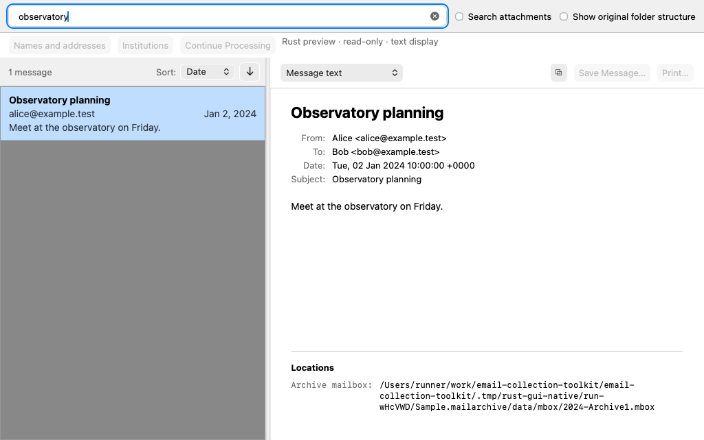
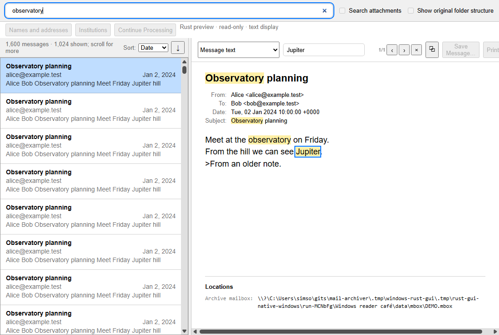

<!-- Copyright (C) 2026 Simson L. Garfinkel. All Rights Reserved. -->

# Rust GUI experiments

The **Rust GUI migration is retired** as of October 10, 2026. Python/pywebview
is again the default desktop application on macOS and Windows. The GUI source
in [`rust/mailsearch-gui/`](../rust/mailsearch-gui/) is preserved for study. It is not a
working, supported application or a release target: it is outside the supported
Cargo workspace, and the historical Make GUI targets stop with a retirement
message. Do not use an old executable as if it were the current product.

**Build status:** the last supported migration snapshot,
`3aae0de4084ff958cabc5f355b9e424836662760`, compiled and passed its macOS and
Windows CI. There was no demonstrated compiler failure at retirement. The
current root workspace no longer builds it; `cargo build -p mailsearch-rust`
fails because that package is excluded. Standalone reconstruction is unsupported
and may require repairing dependencies, build metadata, resources and packaging.
Compilation of this retained experiment is no longer maintained or guaranteed.
This is an abandoned migration, not a claim that Rust cannot implement this UI.

The independent archive verifier, MCT importer tools, PST tools, streaming MIME
transfer decoder and build runner remain supported workspace members. Their
format, Clippy and real fixture tests remain part of `make rust-check` and
`make check`; their source is not retired with the GUI.

## What we tried

The goal was to replace the Python desktop shell without changing the archival
contract: original RFC 5322 bytes, MBOX, SHA-256 manifests, and rebuildable SQLite
catalogues and FTS5 indexes. Dioxus and Tauri were documented as candidate
frameworks. The implemented experiment used Wry/Tao with system WKWebView on
macOS and WebView2 on Windows, plus an earlier egui comparison reader. A working
Dioxus or Tauri implementation was not delivered.

The Wry shell reused the production HTML/CSS/JavaScript interface. A local IPC
adapter routed its calls to Rust services. Rust implemented query compilation,
search workers, autocomplete, result paging, filters, catalogue and MBOX reading,
hash verification, MIME rendering, attachments, document/window routing, menus,
dialogs, clipboard/export/printing/drag adapters and update integration. These
were implementations at different levels of acceptance, not a completed parity
claim. The earlier egui frontend was a comparison tool, not a replacement for
all Python workflows.

**Ingest remained in Python.** The Rust GUI started a private
`mailarchiver.rust_engine` process and sent requests over stdin/stdout. The helper
called the existing ingest engine to preserve message bytes, write MBOX and
manifests, update databases/indexes and handle recovery. Rust managed the window,
progress, cancellation, search, reading and independent verification. Hot-journal
recovery was moved into a foreground job with elapsed time and Abort; aborting
prevented opening the archive. Python was bundled into installers; end users
were not meant to install a runtime or run a separate service.

Packaging replaced the macOS application executable while retaining the bundle
identity, document association and update feed, with the frozen Python helper
beside it. Windows packages combined Rust executables, private Python and
WinSparkle. Shared Rust update configuration and feed verification supported
platform adapters for macOS Sparkle and Windows WinSparkle. Developer ID,
notarization, MSIX test signing, installed-package checks and complete-feed
signature checks were added or strengthened. Python packaging now supplies the
application executable; Rust updater adapters remain historical source.

## What worked, and how it was tested

Independent byte/fixity verification and retained importer/decoder improvements
are useful outside this experiment. The GUI could open archives, search, show
messages and call Python workflows. Real CLI-created synthetic archives were
used for Rust unit/integration, Python/Rust interoperability, shared optimizer
cases, headless browser checks, native smoke and mounted installer checks.
Windows x64 and ARM64 packages were installed, activated, upgraded and removed
on native CI runners. Synthetic source and archive inventories established byte
preservation for the paths exercised.

Tests found and repaired concrete defects: sandboxed editor IPC, stale policy
snapshots, unsupported Windows writes, misreported imports after preference
failures, foreground recovery cancellation, helper-startup readiness, bounded
record verification, recent-document lost updates, HTML-frame readiness,
message part preference retention and autocomplete/search coordination. These
repairs did not establish full native parity or acceptable performance on all
large collections. Physical cross-app dragging, full window/document coordination
and every packaged interaction were not fully accepted before retirement.

## What did not meet the goal

The user repeatedly observed worse first-result responsiveness than Python on
a large real archive, including roughly 5–10 seconds for broad `hello` searches
while Python often showed initial results in 1–2 seconds. Autocomplete and HTML
viewing also showed visible regressions during testing. Bringing SQL and query
plans into alignment was necessary but insufficient: result staging, worker
coordination, cancellation, cache state and time to the first displayed batch
also mattered. Passing an indexed EXPLAIN plan or a warm SQL benchmark did not
prove comparable user experience.

Read-only diagnosis on the large index separated FTS matching from candidate
metadata lookup and sorting. First result selection did not need MBOX reads;
MBOX is used when a selected message is read. A measured broad-query worker
needed about 8 seconds initially and about 0.55 seconds immediately after
priming the same SQL. This supports cache-sensitive database access as a major
factor; it does not isolate physical disk I/O or prove every delay had one cause.
Warm FTS row-ID enumeration was only a few milliseconds; fetching stored FTS
hashes, joining to catalogue metadata and ordering all candidates cost more.
An optimized executable still showed the delay, so a release build was not a
complete explanation or remedy.

Alternative metadata joins and date-index scans improved some warm broad-query
benchmarks. For example, an ordered metadata join measured roughly 0.24 seconds
versus 0.39 seconds for the original hash path. A date/row-ID scan measured about
0.02 seconds for the broad query but roughly 3.9 seconds for a sparse query
that the original plan answered in a few milliseconds. No universal replacement
was established. Removing category filtering or the stable pagination tie-breaker
was not proved to solve the observed end-to-end delay. A read-only audit found
no missing or mismatched metadata links in the actual index; hypothetical stale
links were not an observed cause.

Native integration also required substantial platform-specific work despite
reusing the interface. File packages, Dock/Finder events, webview readiness,
window lifetimes, printing, dragging, permissions and updater shutdown each had
separate acceptance boundaries. Synthetic drag events and browser tests could
not prove physical cross-application dragging. Foreground automation was
intrusive, and the user took over physical interaction testing.

## Lessons and final decision

A language rewrite is not itself a performance optimization. Compare the real
first-result path, identical queries and datasets, cold and warm behavior,
completion latency and first paint before changing the shell. Keep one query
compiler per implementation and share the acceptance/optimizer case matrix,
but also test scheduling and end-to-end responsiveness. Preserve bytes and
hashes across language boundaries; treat parsers and indexes as derivatives.

Rust ownership can support efficient streaming, but unnecessary payload copies
still appeared and were audited. Borrowing and bounded buffers improved memory
behavior; batching decoder output mattered more than merely replacing clones.
Independent review caught a per-byte callback performance regression. These
lessons apply to the maintained tools as well as future experiments.

A private worker preserved the existing ingest engine, but added process,
protocol, cancellation and packaging responsibilities. Prefer an incremental
replacement justified by measured gains over simultaneous UI, search, lifecycle
and distribution rewrites. Keep correctness reviews bounded and combine them
with representative user testing early.

Python now works on Windows and remains the better accepted GUI. The user chose
to stop this migration and merge the useful non-GUI work while preserving the
experiment. Python owns the desktop, search and ingest in the default product;
Rust tools remain where they already provide independent verification or import
services. No future Rust GUI completion is promised.

## Reconstructing historical work

Start from the immutable last compiling snapshot above in an isolated checkout,
not the current supported build. It used Rust 1.99 and the mapped release identity
from `pyproject.toml`. Framework dependencies, platform SDKs, GUI resources and
Python helper discovery must all match that snapshot. Do not ingest into a real
archive as an experiment. The retained `ci/` files describe historical native
and MSIX tests and are no longer active GitHub workflows.

## Frameworks and acceptance history

The September Dioxus/Tauri proposal never produced either comparable trial.
The later Wry/Tao implementation and earlier egui reader are the experiments
actually built. Neither framework proposal is an active roadmap.

| Evidence | What it establishes | Remaining limits |
| --- | --- | --- |
| macOS CI snapshot `ae69d7546ed4f55e492d6628cde922c088d7ce9e` ([run 37232804538](https://github.com/simsong/email-collection-toolkit/actions/runs/37232804538)) | Native WKWebView search, selection, rendering, PNG and synthetic archive fixity | Historical snapshot, not current application acceptance |
| October 6 macOS native trials | Helper-present/absent reading; owner/identity edits; verified exports; menu editing; printed PDF; attachment Save/Open/Cancel | Physical Finder dragging and full application-wide document coordination incomplete |
| Windows CI commit `4912379` ([run 37677162147](https://github.com/simsong/email-collection-toolkit/actions/runs/37677162147)) | Shared x64/ARM64 Rust MSIX build, install, activation, private helper, search, window, upgrade, uninstall | Does not validate current x64 Python packages or Windows imports |
| Final compiling snapshot `3aae0de4084ff958cabc5f355b9e424836662760` | Historical cross-platform compilation and CI | Retained GUI is excluded from today's workspace |

## Search and native integration lessons

Python and Rust compared ordered IDs, headers, counts, selectors, date boundaries,
folder filters, completion and indexed query plans using shared synthetic cases.
The reader staged recent previews before comprehensive results, retained two
512-entry preview windows and paged 512 results. Cancellation and first-result
latency required separate measurement from total SQL time. A 16 MiB record limit
and 256 KiB text/raw display limit were prototype constraints, not archive limits.

Both readers recovered canonical bytes by their declared hash before MIME display.
Malformed decoding used derived fallbacks; untrusted HTML stayed isolated, remote
images needed consent, and temporary exports were cleaned on closure. Rust's
archive opener rejected escaping database/MBOX paths and WAL databases. Foreground
hot-journal recovery used the Python helper, writer exclusion, elapsed time and
Abort; successful opening required revalidation after actual helper completion.

Updater shutdown needed a real worker-cleanup acknowledgment and exclusive writer
fence. A timeout could not authorize installation. Failed/canceled updates restored
the reader while retaining any staged-installer hazard until native cancellation.
These historical mechanisms do not substitute for today's Python lifecycle tests.

## Historical build and test interpretation

The snapshot used Rust 1.99, Wry/Tao, platform SDKs and the snapshot's Python
environment. Windows native builds used MSVC, a matching Windows SDK and WebView2.
The old `rust-gui`, `rust-gui-egui`, `rust-dmg`, `test-rust-gui*`,
`test-rust-webview`, `test-rust-recovery`, `test-rust-engine` and search-parity
Make targets are retired. Reconstruct only in an isolated historical checkout
using synthetic mail. Current run commands belong in [CLI_REFERENCE.md](CLI_REFERENCE.md).

The old native smoke used feature `native-smoke`, real CLI-created archives,
source/archive hash inventories, UI search/selection and a webview screenshot.
Headless browser/RPC tests exercised real workers but did not prove physical
clipboard, drag, printing or installed update/relaunch behavior.

| Historical variable | Purpose |
| --- | --- |
| `ECT_RUST_ENGINE_PYTHON` | Private archive-service interpreter override |
| `RUST_GUI_BINARY`, `RUST_WEBVIEW_BINARY` | Executables selected by interoperability/browser fixtures |
| `RUST_GUI_DEMO`, `RUST_GUI_ARTIFACT_DIR` | New synthetic fixture and retained native evidence destinations |
| `ARCHIVE`, `QUERY` | Reader fixture and smoke/probe query |
| `ECT_RUST_WEBVIEW_DIAGNOSTICS` | Native navigation/IPC URL diagnostics, without request bodies |
| `ECT_RUST_PREFERENCES_TEST_ROOT`, `ECT_RUST_PREFERENCES_TEST_EDIT` | Isolated preference-writer fixtures |
| `ECT_RUST_NATIVE_CLOSE_SMOKE` | Feature-gated close-during-search fixture |
| `ECT_RELEASE_VERSION`, `ECT_RELEASE_BUILD`, `ECT_RELEASE_CHANNEL` | Public build metadata from the release mapper |
| `ECT_UPDATE_FEED_URL`, `ECT_UPDATE_PUBLIC_KEY` | Public updater configuration |
| `ECT_WINSPARKLE_TEST_DLL` | Checksum-verified test SDK DLL |

Reader preferences lived outside archives, using `LOCALAPPDATA` on Windows,
Application Support on macOS and XDG configuration on Linux. Windows `APPDATA`
was consulted for older Python update preferences. Current supported compiler
and output overrides are documented in the root README and Makefile.
